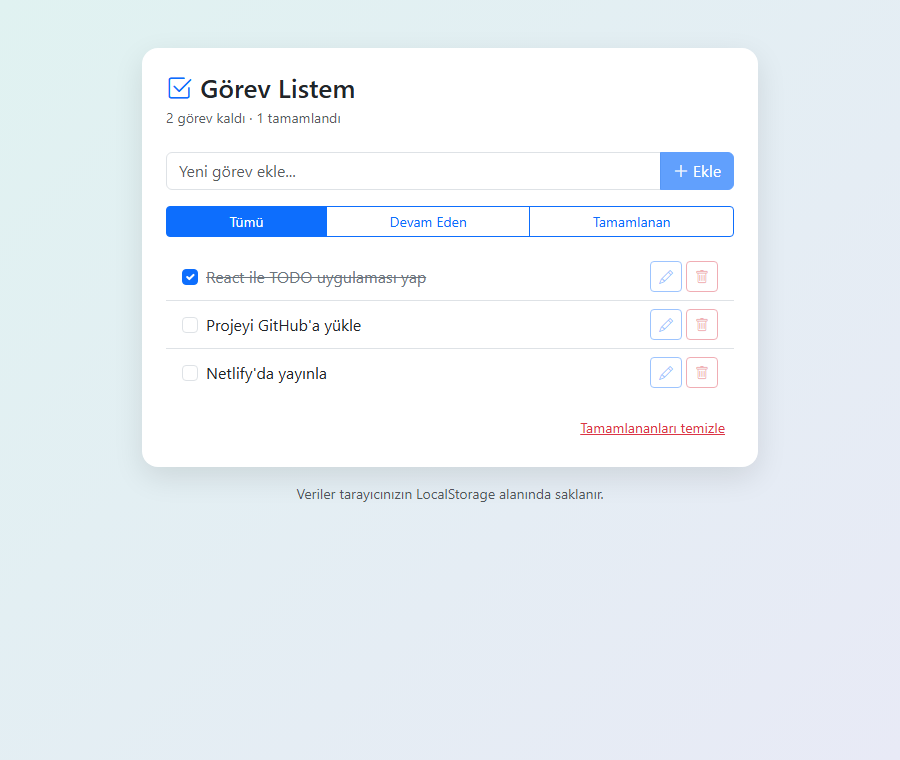

# Görev Listem – React TODO Uygulaması

React, Vite ve Bootstrap 5 ile geliştirilmiş basit bir TODO uygulamasıdır. Görev **ekleme, listeleme, güncelleme ve silme** işlemlerini yapar; veriler tarayıcının **LocalStorage** alanında saklanır, sayfa yenilense de kaybolmaz.

🔗 **Canlı uygulama:** _Netlify linki buraya eklenecek_



## Özellikler

- ➕ **Ekleme:** Üstteki kutuya yazıp Enter'a basarak ya da "Ekle" ile yeni görev ekleyin.
- 📋 **Listeleme:** Tüm görevler listelenir; Tümü / Devam Eden / Tamamlanan filtresi vardır.
- ✏️ **Güncelleme:** Kalem simgesiyle görev metnini düzenleyin (Enter kaydeder, Esc vazgeçer). Kutucukla görevi tamamlandı olarak işaretleyin.
- 🗑️ **Silme:** Çöp kutusu simgesiyle görevi silin. "Tamamlananları temizle" ile hepsini birden kaldırın.
- 💾 **LocalStorage:** Veriler tarayıcıda saklanır.

## Kullanılan Teknolojiler

- React 19 (Hooks: `useState`, `useEffect`)
- Vite
- Bootstrap 5 ve Bootstrap Icons

## Klasör Yapısı

```
src/
├── components/   TodoForm, TodoList, TodoItem
├── pages/        Home
├── hooks/        useLocalStorage
├── App.jsx
├── main.jsx
└── index.css
```

## Kurulum ve Çalıştırma

Gereksinim: [Node.js](https://nodejs.org) 18 veya üzeri.

```bash
git clone https://github.com/irfankubus/todo-app.git
cd todo-app
npm install
npm run dev
```

Tarayıcıda terminalde yazan adresi açın (genellikle `http://localhost:5173`).

> Windows PowerShell'de "running scripts is disabled" hatası alırsanız `npm.cmd install` ve `npm.cmd run dev` komutlarını kullanın.

Yayın için derleme:

```bash
npm run build
```

Çıktı `dist/` klasörüne yazılır. Netlify'da `Build command: npm run build`, `Publish directory: dist` ayarlarıyla yayınlanır (`netlify.toml` içinde tanımlıdır).
